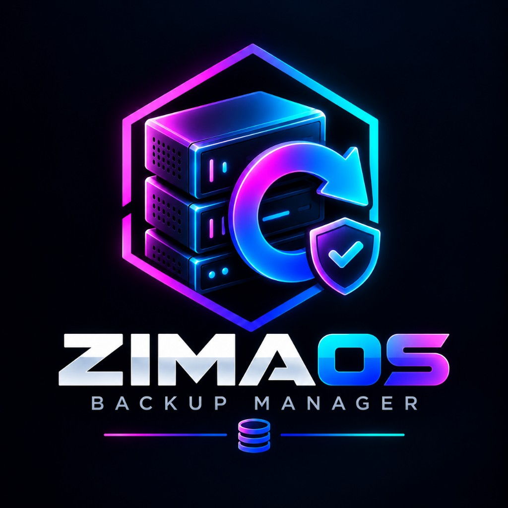

# ZimaOS Backup Manager

<p align="center">
  
</p>

**Zentrale Weboberfläche** für vorhandene ZimaOS-Backups auf ZimaCube / ZimaCube Pro — starten, überwachen, planen, Discord-Benachrichtigungen. Keine eigene Backup-Engine.

[](https://github.com/MarcelRuh/zimaos-backup-manager/actions/workflows/ci.yml)
[](https://github.com/MarcelRuh/zimaos-backup-manager/pkgs/container/zimaos-backup-manager)
[](https://github.com/MarcelRuh/zimaos-backup-manager/releases)
[](./LICENSE)

> Status: **v0.1.8** — Dark-Neon UI, Compose→AppData nach ZimaOS-Backup, Docker/GHCR.

Nutzt ausschließlich die bestätigte ZimaOS-Backup-API. ZimaOS selbst wird nicht verändert.

## Features

- Automatische Erkennung vorhandener Backup-Tasks
- Dashboard mit Statusübersicht und API-Verbindung
- Manuelles Starten inkl. Preflight-Checks
- Robuste Überwachung (kein falscher Erfolg bei altem `completed`)
- Zeitpläne (täglich/wöchentlich/monatlich/Cron), Zeitzone konfigurierbar
- Discord-Webhook-Benachrichtigungen (Erfolg/Fehler)
- Persistente Historie in SQLite
- Sichere lokale Anmeldung (Argon2id, HTTP-only Cookies, CSRF, Brute-Force-Schutz)
- Dark-Neon UI, Deutsch/Englisch
- Optional: CasaOS-Compose-Dateien (`/var/lib/casaos/apps`) als tar.gz sichern
- Ein Container, Multi-Arch (`amd64`/`arm64`), GHCR-Release

## Screenshots

Platzhalter unter `docs/screenshots/` — nach dem nächsten Deploy ergänzen.

## Stack

| Layer | Tech |
|-------|------|
| UI | React 19, Vite, Tailwind CSS |
| API | Go 1.27, SQLite |
| Runtime | Docker Compose / ZimaOS |

## Bestätigte ZimaOS-API

```http
GET  /v2/backup/tasks
POST /v2/backup/tasks/{id}/start
```

Login für Container-Zugriff: `POST /v1/users/login`. Details: [docs/LIMITATIONS.md](docs/LIMITATIONS.md)

## Quick start (Docker Compose)

```bash
git clone https://github.com/MarcelRuh/zimaos-backup-manager.git
cd zimaos-backup-manager
cp .env.example .env
docker compose up -d
```

WebUI: `http://<host>:8787`

Image: `ghcr.io/marcelruh/zimaos-backup-manager`

### Netzwerk zur ZimaOS-API

```yaml
extra_hosts:
  - "host.docker.internal:host-gateway"
environment:
  ZIMAOS_API_BASE_URL: http://host.docker.internal
```

### ZimaOS-API-Login

Vom Container aus antwortet ZimaOS meist mit `401`. Unter **Einstellungen** Benutzername/Passwort hinterlegen (oder `ZIMAOS_API_USERNAME` / `ZIMAOS_API_PASSWORD`). Der Manager meldet sich über `/v1/users/login` an und erneuert Tokens automatisch.

## Installation auf ZimaOS

Compose mit `x-casaos`-Metadaten: [deploy/zimaos/docker-compose.yml](deploy/zimaos/docker-compose.yml)

## Ersteinrichtung

1. WebUI öffnen
2. Administrator anlegen (kein Default-Passwort)
3. ZimaOS-Zugangsdaten prüfen
4. Backups erscheinen automatisch

## Discord

Unter **Benachrichtigungen**: Webhook, global/je Task, Erfolg/Fehler, Test senden. Keine Fortschrittsmeldungen — maximal eine Abschlussmeldung pro Durchlauf.

## Fehlerbehebung

| Symptom | Prüfung |
|---|---|
| Keine Tasks | API-URL, Token, Host-Gateway, Firewall |
| `api_unavailable` | `ZIMAOS_API_BASE_URL`, Login, Host-Erreichbarkeit |
| Start blockiert | Task läuft / Ziel offline / Task deaktiviert |
| Discord ohne Nachricht | Webhook + Flags; nur Erfolg/Fehler |
| `/data` nicht beschreibbar | Image ≥ `0.1.1` (Entrypoint chown) |

## Sicherheit

- Argon2id, HTTP-only Cookies, CSRF, Lockout
- ZimaOS-Passwort at-rest AES-GCM (`DATA_DIR/.encryption-key`)
- Secrets nicht im Frontend zurückgeben
- Siehe [SECURITY.md](SECURITY.md)

## Build für Entwickler

Voraussetzungen: Go 1.27+, Node 22+, Docker (optional)

```bash
cd backend && go test ./...

cd frontend
npm ci
npm test
npm run build

cd backend
set DATA_DIR=../data
set ZIMAOS_API_BASE_URL=http://127.0.0.1
go run ./cmd/server
```

## Lizenz

MIT – siehe [LICENSE](LICENSE)
